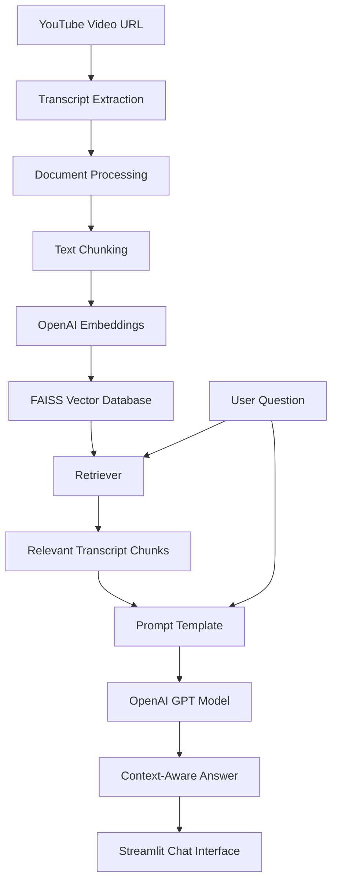

# 🎥 YouTube RAG Chatbot | LangChain + OpenAI + Streamlit

An AI-powered YouTube chatbot that allows users to interact with YouTube videos through natural language questions. Built using **LangChain, OpenAI, FAISS, and Streamlit**, this project implements a Retrieval-Augmented Generation (RAG) pipeline to retrieve relevant information from video transcripts and generate context-aware answers.

Instead of watching an entire video to find specific information, users can simply paste a YouTube URL and ask questions about its content.

---

## 🚀 Features

- **YouTube Transcript Extraction:** Extracts available transcripts from YouTube videos.
- **Document Processing:** Splits transcripts into smaller, manageable text chunks.
- **Text Embeddings:** Uses OpenAI's `text-embedding-3-small` model to convert text into vector representations.
- **Vector Database:** Stores and searches embeddings using FAISS.
- **Semantic Search:** Retrieves the most relevant transcript chunks based on user queries.
- **AI-Powered Responses:** Uses OpenAI GPT models to generate answers grounded in retrieved context.
- **Interactive Chat Interface:** Provides a user-friendly chatbot interface using Streamlit.
- **Source Retrieval:** Displays relevant transcript chunks used to generate answers.

---

## 🏗️ System Architecture

The application follows a Retrieval-Augmented Generation (RAG) architecture.



### RAG Workflow

1. The user provides a YouTube video URL.
2. The application extracts the video transcript.
3. The transcript is split into smaller chunks using LangChain's `RecursiveCharacterTextSplitter`.
4. OpenAI embeddings convert the chunks into numerical vectors.
5. FAISS stores the generated vectors.
6. When a user asks a question, the retriever performs semantic similarity search.
7. The most relevant chunks are passed to the GPT model as context.
8. The LLM generates an answer based on the retrieved information.
9. The answer and retrieved source chunks are displayed in Streamlit.

---

## 🛠️ Tech Stack

| Technology | Purpose |
|---|---|
| Python | Core programming language |
| Streamlit | Interactive web application |
| LangChain | RAG pipeline orchestration |
| OpenAI GPT | Natural language response generation |
| OpenAI Embeddings | Text vectorization |
| FAISS | Vector storage and similarity search |
| YouTube Transcript API | Transcript extraction |
| Python-dotenv | Environment variable management |

---

## 📂 Project Structure

```text
Youtube_RAG_Chatbot/
│
├── app.py
├── requirements.txt
├── .env.example
├── .gitignore
│
├── src/
│   ├── __init__.py
│   ├── transcript.py
│   ├── document_processor.py
│   ├── vector_store.py
│   └── rag_pipeline.py
│
├── test_transcript.py
├── test_document_processor.py
├── test_vector_store.py
└── test_rag_pipeline.py
```

### Module Responsibilities

- `app.py` – Streamlit frontend and application integration.
- `transcript.py` – Extracts YouTube video IDs and transcripts.
- `document_processor.py` – Converts transcripts into LangChain documents and splits them into chunks.
- `vector_store.py` – Generates embeddings and manages the FAISS vector database.
- `rag_pipeline.py` – Implements retrieval, prompt construction, and LLM response generation.

---

## ⚙️ Installation and Setup

### 1. Clone the Repository

```bash
git clone https://github.com/neharai2/Youtube_RAG_Chatbot.git

cd Youtube_RAG_Chatbot
```

### 2. Create a Virtual Environment

```bash
python3 -m venv venv
```

Activate the environment.

**Mac/Linux:**

```bash
source venv/bin/activate
```

**Windows:**

```bash
venv\Scripts\activate
```

### 3. Install Dependencies

```bash
pip install -r requirements.txt
```

### 4. Configure OpenAI API Key

Create a `.env` file in the root directory.

Add your OpenAI API key:

```env
OPENAI_API_KEY=your_openai_api_key
```

You can obtain an API key from:

https://platform.openai.com/api-keys

**Important:** Never commit your `.env` file or expose your API key publicly.

### 5. Run the Application

```bash
streamlit run app.py
```

Open the application in your browser:

```text
http://localhost:8501
```

---

## 💬 How to Use

1. Launch the Streamlit application.
2. Paste a valid YouTube video URL into the sidebar.
3. Click **Process Video**.
4. Wait for transcript extraction, document processing, and embedding generation.
5. Once processing is complete, enter your question in the chat interface.
6. Receive an AI-generated response based on the video transcript.
7. Expand the retrieved sources section to inspect the supporting transcript chunks.

---

## 🧠 Key RAG Concepts Implemented

### 1. Document Chunking

Uses `RecursiveCharacterTextSplitter` to divide transcripts into smaller chunks.

Initial configuration:

- Chunk Size: 500 characters
- Chunk Overlap: 100 characters

### 2. Embeddings

Uses OpenAI's `text-embedding-3-small` embedding model to transform transcript chunks into vector representations.

### 3. Vector Search

FAISS performs similarity search to identify the most relevant transcript chunks for a given query.

### 4. Retrieval-Augmented Generation

The retrieved chunks are combined with the user's question and passed to an OpenAI GPT model through a LangChain prompt template.

The model generates responses using the retrieved context rather than relying entirely on its general knowledge.

---

## 🔮 Future Improvements

- [ ] Conversational RAG with follow-up question support.
- [ ] Multi-video support and video-specific vector indexes.
- [ ] Timestamp-based source citations.
- [ ] Improved transcript processing and retrieval strategies.
- [ ] Streaming AI responses.
- [ ] Video preview and metadata extraction.
- [ ] Improved UI/UX and chat interface.
- [ ] Deployment using Streamlit Community Cloud.
- [ ] Evaluation of retrieval quality and answer accuracy.

---

## ⚠️ Limitations

- Videos must have accessible transcripts or captions.
- Transcript extraction may fail if captions are unavailable or YouTube restricts access.
- OpenAI API access is required for embeddings and LLM responses.
- OpenAI API usage may incur costs.
- The current implementation uses a local FAISS database and processes the selected video when requested.

---

## 👨‍💻 Author

**Neha Rai**

Interested in Generative AI, Large Language Models, Retrieval-Augmented Generation, and AI-powered applications.

GitHub: [@neharai2](https://github.com/neharai2)

---

⭐ If you find this project useful, consider giving the repository a star!
